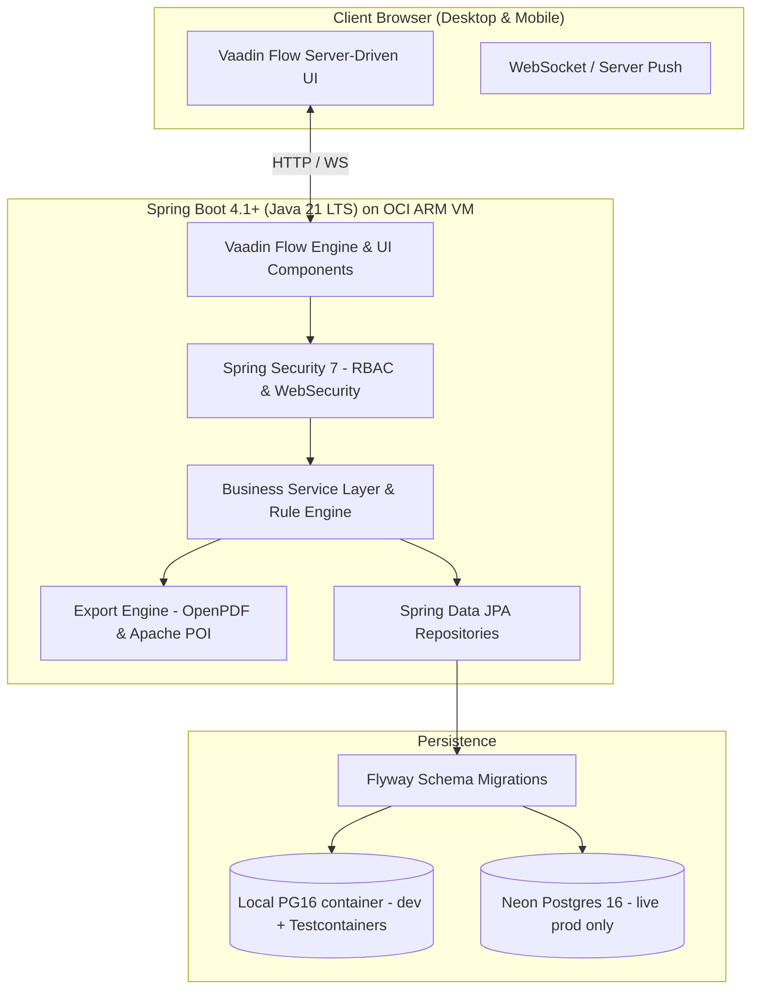
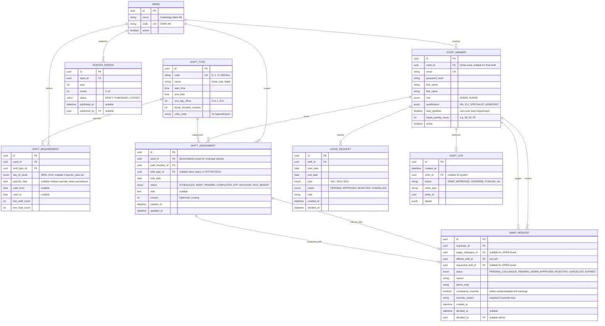
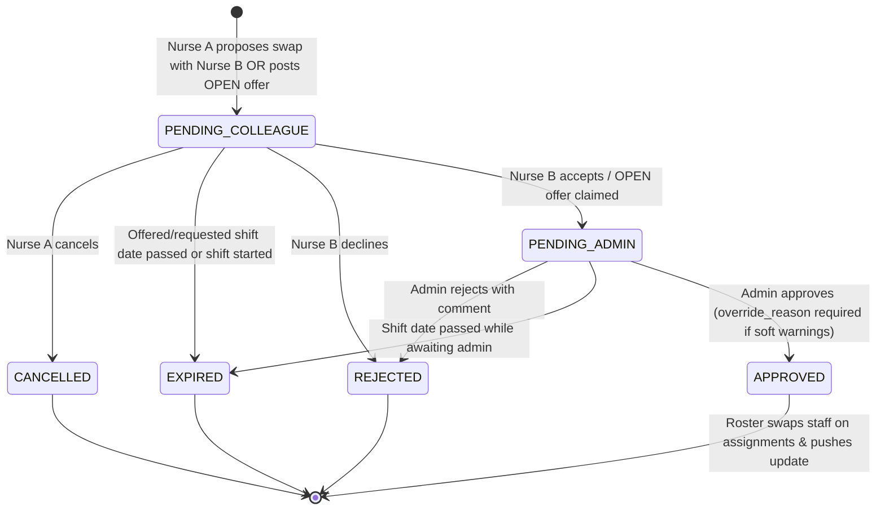

# ShiftWorkr — Senior Portfolio Project Plan

> **Positioning:** An intelligent, enterprise-grade hospital ward scheduling and compliance management platform built with **Java 21, Spring Boot 4, and Vaadin 25 Flow**. Designed as a flagship freelance portfolio piece showcasing complex business logic, reactive real-time collaboration, role-based workflows, and rock-solid software architecture.

- **Author / Developer:** Fabian Bachmayer ([bachi.dev](https://bachi.dev))
- **Live Target:** Hosted on **Oracle Cloud Infrastructure (OCI) Always-Free Tier** with automatic SSL via Caddy. Production database on **Neon Postgres**. Local development and integration tests use a **local PostgreSQL 16 container / Testcontainers**.
- **Repository Target:** `C:\Users\Fabian\dev\shiftworkr` (GitHub: `BachiDev/shiftworkr`)
- **Brand Coherence:** Styled to align seamlessly with `bachi.dev`'s dark aesthetic, violet/fuchsia accent ramp, and strict typography rules.

---

## 1. Executive Summary & Portfolio Intent

### Why this project wins freelance clients
Freelance enterprise clients don't hire Java full-stack developers for simple CRUD or generic blog engines. They hire developers who can tackle:
1. **High Data Density & Complex UIs:** Managing 30+ nurses across 31 days with multi-shift rotations without lag or clutter.
2. **Strict Business Domain Constraints:** Labor law compliance, mandatory rest periods, skill-mix quotas, and overtime thresholds.
3. **State Machine Workflows:** Multi-step approval lifecycles (Shift Swap between Nurse A $\rightarrow$ Nurse B $\rightarrow$ Ward Admin, plus Open Board claims).
4. **Real-time Server-Driven UI:** Instant live roster updates via WebSockets (`@Push`) without client-side state synchronization bugs.
5. **Production Engineering Rigor:** Multi-stage Docker builds, Flyway versioned migrations, Testcontainers integration testing, and hardened Spring Security.

---

## 2. Visual Design System & Brand Coherence

The UI strictly adheres to the design tokens established in [bachi.dev](file:///C:/Users/Fabian/dev/bachidev-github-io/PLAN.md), adapted into Vaadin's Lumo theme engine via custom CSS tokens (`src/main/frontend/shiftworkr-styles.css`, loaded with `@CssImport` in the Vaadin 25 theming model).

```
                ┌──────────────────────────────────────────────┐
                │             Zinc-950 Base (#09090b)          │
                │  ┌────────────────────────────────────────┐  │
                │  │       Zinc-900 Raised Surface          │  │
                │  │  ┌──────────────┐   ┌───────────────┐  │  │
                │  │  │ Early Shift  │   │  Night Shift  │  │  │
                │  │  │ Violet Accent│   │ Fuchsia Accent│  │  │
                │  │  └──────────────┘   └───────────────┘  │  │
                │  └────────────────────────────────────────┘  │
                └──────────────────────────────────────────────┘
```

### 2.1 Design Tokens

| Token Category | Value / Variable | Purpose / Usage |
| :--- | :--- | :--- |
| **Base Background** | `zinc-950` (`#09090b`) | Root canvas, app layout backdrop |
| **Raised Surfaces** | `zinc-900` (`#18181b`) | Card surfaces, modal dialogs, schedule grid cells |
| **Card Borders** | `rgba(255, 255, 255, 0.08)` | Subtle division, no harsh contrast |
| **Primary Accent** | `violet-500` (`#8b5cf6`) / `violet-400` (`#a78bfa`) | Primary buttons, active tabs, early shifts, focus rings |
| **Secondary Accent**| `fuchsia-500` (`#d946ef`) | Gradient highlights (`violet` $\rightarrow$ `fuchsia`), night shifts |
| **Status: Success** | `emerald-500` (`#10b981`) / `emerald-400` | Fully staffed badge, approved swap, active status |
| **Status: Warning** | `amber-500` (`#f59e0b`) / `amber-400` | Soft-rule warning, understaffed shift, overtime, rest < 11h (overridable) |
| **Status: Danger**  | `rose-500` (`#f43f5e`) / `rose-400` | Hard-rule block, uncovered critical shift, illegal transition |
| **Status: Info**    | `sky-500` (`#0ea5e9`) | Late shift, leave requests, open swap requests |
| **Typography Sans** | `Inter` / `Geist Sans` | Body copy, dialog headings, navigation (`-0.02em` tracking) |
| **Typography Mono** | `JetBrains Mono` / `Geist Mono` | Shift time badges, staff IDs, overtime counts, kickers |

### 2.2 Shift Color Coding (Accessible & High Contrast)
- **Early Shift (`E` / 06:00–14:30):** Violet tint (`bg-violet-950/60 text-violet-300 border-violet-800/40`)
- **Late Shift (`L` / 14:00–22:00):** Sky tint (`bg-sky-950/60 text-sky-300 border-sky-800/40`)
- **Night Shift (`N` / 21:30–06:30+1):** Fuchsia tint (`bg-fuchsia-950/60 text-fuchsia-300 border-fuchsia-800/40`)
- **Off / Rest (`OFF`):** Zinc tint (`bg-zinc-900/40 text-zinc-500 border-zinc-800/20`)
- **Vacation / Leave (`VAC`):** Amber tint (`bg-amber-950/40 text-amber-300 border-amber-800/30`)
- **Sick (`SICK`):** Rose tint. **Training (`EDU`, post-MVP):** Sky outline variant.
- Note: E (ends 14:30) and L (starts 14:00) intentionally overlap 30 min for handover. Both count as staffed during overlap; rest-period math uses exact `LocalDateTime` intervals, not day buckets.

---

## 3. System Architecture & Tech Stack



**Database decision (locked):** Local PostgreSQL 16 Docker container for development and Testcontainers integration tests. **Neon Postgres exclusively for the live production site.** No production PG container on OCI. This keeps local iteration fast/offline and gives prod managed backups, branching, and pooled connections.

### 3.1 Technology Matrix

| Layer | Technology | Justification |
| :--- | :--- | :--- |
| **Runtime & Language** | **Java 21 LTS** | Virtual threads (Project Loom), pattern matching, records, sealed types. |
| **Application Framework** | **Spring Boot 4.1.x** | Enterprise gold standard; flawless freelance marketability. |
| **Frontend Framework** | **Vaadin 25.3 (Flow)** | 100% Java type-safe UI, zero client API glue, built-in WebSocket `@Push`. Vaadin 25 (free maintained line) requires Boot 4 / Framework 7 / Java 21+. |
| **Security & Auth** | **Spring Security 7** | Role-based view access (`@RolesAllowed` on view classes), session fixation protection, Vaadin CSRF handling. |
| **Database (dev/test)** | **PostgreSQL 16 (local Docker + Testcontainers)** | Fast offline iteration, real-PG integration tests. Compose service `db` only in `docker-compose.dev.yml`. |
| **Database (prod)** | **PostgreSQL 16 on Neon (live site only)** | Managed backups, branching, scale-to-zero + pooling. App connects via `JDBC_URL` secret + `sslmode=require`. |
| **Persistence & ORM** | **Spring Data JPA / Hibernate 6** | Enterprise repositories, custom JPQL queries, optimistic locking (`@Version`) + pessimistic locks for swaps. |
| **Schema Migrations** | **Flyway** | Production-grade versioned database evolution (`V1__init.sql`, etc.). Same migrations run against local PG and Neon. Checked in CI. |
| **Reporting / Export** | **OpenPDF + Apache POI** | Weekly printable PDF ward bulletin + monthly Excel audit workbook. |
| **Containerization** | **Docker (Temurin 21: Jammy builder + Alpine runtime)** | Jammy builder for Vaadin Node/glibc reliability; Alpine runtime for minimal CVE surface. Non-root user, tuned JVM flags. |
| **Reverse Proxy & SSL** | **Caddy Server** | Automated Let's Encrypt SSL, reverse proxy to Spring Boot container. Neon needs no proxy. |
| **Testing** | **JUnit 5 + Testcontainers + Karibu** | Unit tests for rules, real Postgres integration tests, headless Vaadin UI tests. No Playwright in MVP (Karibu is sufficient). |

---

## 4. Domain Model & Business Logic



### 4.1 Integrity Constraints (enforced in Flyway V1 + JPA)

- **Partial Unique Index on Assignments:** One active row per staff per day (MVP — including `ONCALL`). `NULL shift_type_id` for `OFF/VACATION/SICK` is fine because the index does not include `shift_type_id`:
  `CREATE UNIQUE INDEX idx_unique_active_assignment ON shift_assignment (staff_member_id, shift_date) WHERE status IN ('SCHEDULED', 'SWAP_PENDING', 'COMPLETED', 'OFF', 'VACATION', 'SICK');`
  `ABSENT` rows are intentionally excluded (multiple absence records per day allowed for audit). Post-MVP: revisit second-row `ONCALL` support with an explicit `AND shift_type_code <> 'ONCALL'` exemption.
- `OFF/VACATION/SICK` are explicit rows (not absence of row) so consecutive-day rules can distinguish "rest day" from "unscheduled".
- `UNIQUE(ward_id, year, month)` on `roster_period`. `UNIQUE(shift_type.code)`, `UNIQUE(ward.code)`, `UNIQUE(staff.email)`.
- `CHECK (end_day_offset IN (0,1))`, `CHECK (target_weekly_hours BETWEEN 10 AND 48)`, `CHECK (min_lead_count <= min_staff_count)`.
- Indexes: `idx_assignment_ward_date (ward_id, shift_date)` (coverage queries), `idx_requirement_ward_dow (ward_id, day_of_week)`, `idx_swap_status (status)`, `idx_leave_staff_dates`. No separate `idx_assignment_staff_date` — the partial unique index above already covers `(staff_member_id, shift_date)` lookups.
- **Timezone (locked):** All shift intervals computed in `Europe/Berlin` (`ZonedDateTime`), stored as `timestamptz` (UTC) in Postgres. `shift_date` is the wall-clock date in Berlin. DST transitions handled explicitly: Night shift on Oct clock-change = 10h paid (minus break), Mar clock-change = 8h. App `spring.jpa.properties.hibernate.jdbc.time_zone: UTC`, JVM `-Duser.timezone=Europe/Berlin` for display only; rule engine never uses bare `LocalDateTime` math.
- Night shift duration computed as interval: `start 21:30 day D → end 06:30 day D+1 = 9h`. Paid hours = duration minus `break_duration_minutes`.
- Monthly target hours = `target_weekly_hours * 52 / 12`. Overtime = scheduled paid hours − monthly target. Breaks always subtracted.
- Roles are strictly `ADMIN (Ward Lead / manager)` and `NURSE (staff)`. Lead capability is `lead_qualified=true`, not a role. `@RolesAllowed("ADMIN")` on manager views, `@RolesAllowed({"ADMIN","NURSE"})` on staff views. Security is enforced on view classes via `VaadinWebSecurity`, not URL-prefix matching alone.

---

## 5. Core Feature Specifications

### 5.1 Scenario 1: The Interactive Ward Schedule Board (Core UI)
* **View Modes (MVP):** Monthly Matrix View (Rows = Staff, Cols = Days 1–31). Weekly Detailed View is **post-MVP** (cut for 11-day scope).
* **Cell Capabilities:**
  * Displays color-coded shift badge (`E`, `L`, `N`, `OFF`, `VAC`, `SICK`). `OFF/VAC/SICK` are real assignment rows.
  * Single-click / tap opens assignment dialog (mobile-compatible); double-click is a desktop shortcut for the same dialog.
  * Shows rule violation icons: amber triangle = soft warning (overridable), rose octagon = hard block.
* **Ward Coverage Summary Bar (Sticky Footer):**
  * Real-time calculation per day and shift type: e.g., `Fri 18th: E (4/4 ✅) | L (2/3 ⚠️ Understaffed) | N (2/2 ✅)`.
  * Visual alert if no lead-qualified nurse (`lead_qualified=true`) is scheduled on **any** shift (E, L, and N).
  * Debounced recalculation (≥300 ms) + cached requirement lookup to keep 30×31 grid responsive. Frozen first column, virtual scrolling.
* **Filtering & Scoping:**
  * Filter by Qualification (ICU Specialist, RN, Assistant) and lead-qualified-only toggle.
  * Filter by Staff Name or Shift Status.
  * Quick jump to "My Schedule" for non-admin nurses.
  * Ward selector (defaults to home ward; float staff see assigned wards).

### 5.2 Scenario 2: Swap State Machine (1:1 + Open Board)

Two modes share the same table:
- **Direct swap (1:1):** `offered_shift_id + requested_shift_id + target_colleague_id` all set.
- **Open board:** `requested_shift_id=NULL, target_colleague_id=NULL`. Any eligible colleague claims it → transitions to `PENDING_ADMIN` with claimant filled in.



1. **Step 1 (Peer Proposal):** Nurse Alice selects her shift on Oct 24 (Night) and chooses Bob's shift on Oct 26 (Early), or posts OPEN (no target/shift).
2. **Step 2 (Peer Review):** Bob receives an in-app badge and notification. He reviews and clicks **Accept**. OPEN offers show on Swap Board; claim = accept.
3. **Step 3 (Admin Clearance):** Ward Manager sees pending swap in **Approval Queue** with side-by-side comparison. System runs compliance check (rest, 48h limit, lead coverage) and shows **soft warnings (amber, overridable with reason)** vs **hard blocks (rose, cannot approve)**.
4. **Execution:** Single transaction swaps `staff_member_id` on the two assignments (OPEN single-claim: reassigns one assignment). Uses `PESSIMISTIC_WRITE` locks on both assignment rows (`ORDER BY id`) to prevent double-swap. Sets assignments back to `SCHEDULED`, writes `AUDIT_LOG`, and `@Push` broadcasts. Rejected transitions require `admin_note`.

Edge cases handled: shift already `SWAP_PENDING`, shift in past/started, self-swap, swap involving `SICK/VACATION/OFF`, double-claim race on OPEN board, part-time hour impact, loss of lead coverage on either date, and **LOCKED month protection** (swaps involving any date in a `LOCKED` roster period are strictly rejected for all human actors).

### 5.3 Scenario 3: Compliance & Working Time Directive Rule Engine
Configurable thresholds (DB-seeded config, not hardcoded): `min_rest_hours=11, max_consecutive_work_days=6, max_consecutive_nights=3, max_weekly_avg_hours=48 (4-week rolling average for MVP; ArbZG 6-month average is post-MVP)`.

* **Rule 1 — Mandatory 11-Hour Rest (HARD):** Exact `ZonedDateTime` (`Europe/Berlin`) interval math with overnight and DST support. Example: Late ends 22:00 → Early starts 06:00 next day = 8h → hard block unless emergency override with documented reason + audit entry.
* **Rule 2 — Maximum Consecutive Work Days (HARD at >6):** Counts `SCHEDULED/SWAP_PENDING/COMPLETED` as work; `OFF/VACATION/SICK` break the streak. Requires 24h rest after 6.
* **Rule 3 — Night Shift Limit (SOFT at >3):** >3 consecutive N shifts flags amber warning, admin may override with reason.
* **Rule 4 — Target Hours Balance (INFO):** Monthly paid hours (minus breaks) vs `target_weekly_hours*52/12` (e.g., `168h / 160h` → `+8h` amber overtime badge). Part-time pro-rata.
* **Rule 5 — Skill Mix Quota (HARD):** Every **E, L, and N** shift must have ≥1 `lead_qualified` nurse present (configurable via `min_lead_count`). Understaffing (`min_staff_count` unmet) is SOFT warning, lead absence is HARD block for approval/publish.

Severity model: `HARD (rose, blocks approve/publish) | SOFT (amber, allows approve with override_reason + audit) | INFO (display only)`. Every override writes `AUDIT_LOG`.

### 5.4 Scenario 4: Leave & Availability Request Management
* Nurses request `VAC`, `SICK`, or `EDU` (EDU post-MVP) via `leave_request` with `PENDING → APPROVED/REJECTED`.
* Approved leave auto-creates/updates `SHIFT_ASSIGNMENT` rows to `VACATION/SICK` for each date in range (conflicts with `SCHEDULED` surface as warnings to admin).
* Admin views consolidated leave calendar before publishing.
* **Draft vs. Published:** `roster_period.status` controls visibility. `DRAFT` = admin-only editing, staff see last `PUBLISHED`. Publish runs full compliance check; HARD violations block publish. `LOCKED` = past months immutable; any attempt to create/edit shifts, submit swaps, or approve leave for a locked period is rejected at the service layer (admin can unlock only via explicit audit-logged `ADMIN` action with reason). Sole exemption: `SYSTEM` actor may flip `SCHEDULED → COMPLETED` in a `LOCKED` month via nightly job. Staff receive push notification on publish.

### 5.5 Scenario 5: Enterprise Roster Export (PDF & Excel)
* **Print-Ready Weekly PDF Roster (MVP):** Landscape A4, one week per page, hospital branding, ward name, shift legend, lead contact numbers. Monthly PDF explicitly out of scope (unreadable at 30×31).
* **Excel Audit Export:** `.xlsx` workbook with sheets: roster matrix, employee hours/overtime, night-shift counts, leave summary, `AUDIT_LOG` extract for payroll/administration.
* Exports respect role scope (nurses export only own schedule + public coverage; admins export full ward).

### 5.6 Scenario 6: Portfolio Showcase Features ("Instant Demo Mode")
Gated behind Spring profile `demo` (active on preview deployments, **disabled in production against Neon**):
* **One-Click Quick Logins** on login screen (only when `demo` profile active):
  * 🩺 `Login as Sarah Miller (Admin / Ward Lead)`
  * 💉 `Login as Alex Rivera (Nurse)`
* **Pre-seeded Realistic Hospital Data:** `Cardiology Ward 4B` with 16 staff, qualifications, current-month schedule in `roster_period`, 2 pending swaps (1 direct + 1 OPEN), 1 flagged rest-period warning, leave examples.
* **Interactive Guided Tour Banner:** Collapsible, dismissable (persisted in `localStorage`), e.g., *"Try clicking Alex's shift on Thursday to test the 11h rest warning"*.
* Production (`prod` profile + Neon) has no demo buttons and seeds only an initial admin via env-var credentials. Optional nightly reset job only for ephemeral demo env, never prod.

---

## 6. Security & Authorization Architecture

### 6.1 Authentication & RBAC
* Built on **Spring Security 7** with Vaadin's `VaadinWebSecurity`.
* Password hashing with `BCryptPasswordEncoder(strength = 12)` (~250 ms on ARM; acceptable; seeding 16 users is one-time cost).
* Exactly two roles: `ROLE_ADMIN` (Ward Lead / manager) and `ROLE_NURSE` (staff). Lead coverage is a `lead_qualified` flag, not a role.
* View-level access control enforced via `@RolesAllowed` on view classes:
  * `RosterBuilderView`, `StaffManagementView`, `ApprovalQueueView` $\rightarrow$ `@RolesAllowed("ADMIN")`
  * `MyScheduleView`, `SwapBoardView` $\rightarrow$ `@RolesAllowed({"ADMIN","NURSE"})`
* Demo logins only registered when `demo` profile is active. Prod login is standard form login with session fixation protection + Vaadin CSRF.

### 6.2 Data Integrity & Concurrency
* **Optimistic Locking:** All `ShiftAssignment` entities use JPA `@Version`. On `OptimisticLockException`, UI refreshes grid and shows: *"This shift was modified by another manager. Roster refreshed — please retry."*
* **Pessimistic Locking for Swaps:** `SwapRequestService` uses `@Transactional` + `findByIdForUpdate()` (`PESSIMISTIC_WRITE`) locking both assignments `ORDER BY id ASC` to prevent double-swap / double-claim deadlocks. `REPEATABLE_READ` alone is insufficient on Postgres — do not rely on it.
* **State Machine Guards:** Illegal transitions (e.g., `APPROVED → PENDING_ADMIN`) throw `IllegalStateException`; every transition appends `AUDIT_LOG`.
* **Publish Lock:** `roster_period` publish is a single transaction; concurrent publishes serialize on row lock.

---

## 7. Quality Gates & Testing Strategy

```
       ┌──────────────────────────────────────────────────┐
       │  Integration Tests (Testcontainers + Postgres)   │
       ├──────────────────────────────────────────────────┤
       │     Unit Tests (JUnit 5 + Mockito + AssertJ)     │
       └──────────────────────────────────────────────────┘
       + Karibu headless Vaadin view tests (no Playwright in MVP)
```

1. **Unit Tests (`src/test/java/.../domain`):**
   * All 5 compliance rules incl. overnight intervals, consecutive-day streaks broken by OFF/VAC/SICK, overtime with breaks + part-time, lead-coverage on E/L/N, hard vs soft severity.
   * State machine transitions (valid + forbidden jumps, OPEN vs direct, EXPIRED on past dates).
2. **Integration Tests (`src/test/java/.../repository` & `service`):**
   * **Testcontainers** PostgreSQL 16 for Flyway migrations, JPA queries, unique constraints, transactional rollbacks, pessimistic-lock double-claim race.
3. **Vaadin View Tests (`Karibu-Testing`):**
   * Headless component tests: grid rendering, filtering, dialog validation, approval-queue approve/reject with override reason.
4. **CI/CD Pipeline (`.github/workflows/ci.yml`):**
   * Jobs: `test` (`mvn clean verify` + Testcontainers) → `migration-check` (Flyway validate) → `docker-build` (build only, no push on PR). Split jobs for speed; Docker build test on `main` only.

---

## 8. Infrastructure & Deployment Plan

### 8.1 Target Environment

* **Compute:** OCI Ampere A1 (ARM64, 2–4 OCPUs, 12–24 GB RAM, Always-Free). Ubuntu 24.04 LTS (aarch64).
* **Dev/test DB:** Local PostgreSQL 16 container via `docker-compose.dev.yml` (`db: postgres:16`, persistent named volume). No cloud dependency for daily work.
* **Prod DB (live site only):** **Neon Postgres 16** with two endpoints: **pooled (`-pooler` hostname, port `6543`) for runtime**, **direct (port `5432`) for Flyway migrations** (DDL + advisory locks break through PgBouncer transaction pooling). Both `sslmode=require`. Stored as OCI secrets (`JDBC_URL` pooled, `FLYWAY_URL` direct).
* **Prod containers on OCI (`docker-compose.prod.yml`):**
  1. `shiftworkr-app`: Spring Boot + Vaadin (`prod` profile, Hikari → Neon pooled endpoint; Flyway → direct endpoint).
  2. `caddy`: Reverse proxy + auto TLS for `shiftworkr.bachi.dev` → `app:8080`.
  * No prod `db` service.
* **Config:**
  - `application-dev.yml` → local PG container.
  - `application-prod.yml` → pooled `${JDBC_URL}` + Hikari (`maximum-pool-size: 8`, `keepalive-time: 30000`, `idle-timeout: 600000`, `data-source-properties.prepareThreshold=0` for PgBouncer transaction mode) + `spring.flyway.url: ${FLYWAY_URL}` (direct endpoint).
  - Reverse proxy & WebSocket config: `server.forward-headers-strategy: framework` to guarantee Vaadin `@Push` (WebSockets) maintains persistent connection through Caddy without falling back to long-polling.
  - Flyway `validate + migrate` on startup in both environments.
* **Ops:** Caddy auto-HTTPS, `restart: unless-stopped`, `/actuator/health` for liveness (public; all other actuator endpoints locked to `ADMIN`), `journald` log rotation. Neon branching for pre-migration safety. Neon scale-to-zero causes 3–5s cold start on first hit after ~5 min idle — accepted for MVP; optional 5-min uptime ping (e.g. GitHub Actions cron → `/actuator/health`) as post-MVP polish for demo smoothness.

### 8.2 Optimized Multi-Stage Dockerfile (Jammy builder / Alpine runtime)

```dockerfile
# Stage 1: Build & Vaadin Production Bundle (jammy = glibc for Vaadin Node build)
FROM eclipse-temurin:21-jdk-jammy AS builder
# ... pinned Maven 3.9.9 install, then mvn clean package -Pproduction ...
COPY pom.xml ./
RUN mvn dependency:go-offline -B
COPY src src
COPY frontend frontend
RUN mvn clean package -Pproduction -DskipTests

# Stage 2: Minimal Production JRE Runtime (alpine = smallest CVE surface;
# runtime only executes java -jar, no Node/glibc needed)
FROM eclipse-temurin:21-jre-alpine
WORKDIR /app
RUN addgroup -S appgroup && adduser -S appuser -G appgroup
USER appuser
COPY --from=builder /app/target/shiftworkr-*.jar app.jar

EXPOSE 8080
ENV JAVA_OPTS="-XX:+UseG1GC -XX:MaxRAMPercentage=75.0 -XX:+ExitOnOutOfMemoryError"
ENTRYPOINT ["sh", "-c", "java $JAVA_OPTS -jar app.jar"]
```

Split-base rationale: `jammy` builder for reliable Vaadin frontend Node builds and ARM glibc compatibility; `alpine` runtime for minimal attack surface (full Ubuntu userspace in the runtime tripped a HIGH CVE in image scans). No Maven wrapper in repo — the builder installs a pinned Maven binary.

---

## 9. Phased Implementation Roadmap

> MVP cuts applied to fit ~11 days: no Weekly Detailed View, no `EDU` leave type, no monthly PDF, no Playwright. These move to Post-MVP.

### Phase 0: Project Setup & Design System Tokens (Day 1)
- [x] Initialize Spring Boot 4.1 project (Java 21, Spring Data JPA, Spring Security, Vaadin 25, Flyway, PostgreSQL, Lombok).
- [x] Configure `pom.xml` with production profiles, Testcontainers, and Karibu-Testing dependencies.
- [x] Set up Vaadin Lumo Dark custom theme tokens (`styles.css`) matching `bachi.dev` colors (`zinc-950`, `zinc-900`, `violet-500`, `fuchsia-500`).
- [x] Configure Base Application Layout with responsive sidebar navigation and user profile pill.
- [x] Add `docker-compose.dev.yml` (local PG16) + `application-dev.yml`; verify Flyway baseline runs locally.

### Phase 1: Domain Entities, Migrations & Security (Day 2)
- [ ] Write Flyway `V1__init_schema.sql` (wards, roster_periods, staff, shift_types, shift_assignments, swap_requests, leave_requests, shift_requirements, audit_log) with UNIQUEs, CHECKs, indexes from §4.1.
- [ ] Implement JPA Entities with `@Version`, `end_day_offset`, nullable OPEN-board fields, `EXPIRED` status, audit fields.
- [ ] Configure Spring Security with `VaadinWebSecurity`, form login, `UserDetailsService`, 2-role `@RolesAllowed` views.
- [ ] Implement seed service (`demo` profile: 16 staff + roster + swaps + leave; `prod`: admin from env vars only).

### Phase 2: The Interactive Schedule Board (Days 3–4)
- [ ] Build Monthly Ward Schedule Grid (frozen first column, virtual scroll, single-tap dialog + desktop double-click shortcut).
- [ ] Implement color-coded shift badges (`shift-early/late/night/off/vac/sick`) + hard (rose) vs soft (amber) icons.
- [ ] Create Shift Assignment Dialog with shift-type selector, lead-qualified hint, live compliance preview.
- [ ] Implement Sticky Ward Coverage Bar (debounced, cached requirements, lead alert on E/L/N).
- [ ] Enable `@Push` for roster broadcasts; scope updates per ward.

### Phase 3: Shift Swap State Machine & Workflows (Days 5–6)
- [ ] Implement `SwapRequestService` with pessimistic locks (`ORDER BY id`), guard transitions, `EXPIRED` job (nightly `@Scheduled` marking past pending requests).
- [ ] Build Swap Board view (direct + OPEN offers, claim action) for nurses.
- [ ] Build Manager Approval Queue with side-by-side comparison, soft-warning override input (`override_reason` required), hard-block veto.
- [ ] Broadcast push notifications on status change + write `AUDIT_LOG` on every transition.

### Phase 4: Compliance & Rule Engine (Days 7–8)
- [ ] Implement `SchedulingRuleEngine` with injected thresholds config; exact overnight interval math; OFF/VAC/SICK break logic; paid-hours (minus breaks) + pro-rata targets; lead check on E/L/N.
- [ ] Integrate badges into board + approval modal + publish gate (HARD blocks publish).
- [ ] Write unit tests for all rule edge cases (overnight, 6-day boundary, 3-night boundary, part-time overtime, holiday override).

### Phase 5: Enterprise Reporting & Polish (Day 9)
- [ ] Implement `PdfRosterExporter` (weekly landscape A4, ward branding, legend, lead contacts).
- [ ] Implement `ExcelRosterExporter` (roster + hours/overtime + nights + leave + audit_log sheets; role-scoped).
- [ ] Add demo logins + tour banner strictly behind `demo` profile.
- [ ] Add leave calendar + `roster_period` publish/lock flow with push notification.

### Phase 6: Automated Testing & Hardening (Day 10)
- [ ] Testcontainers integration tests (migrations, constraints, swap race, publish lock).
- [ ] Karibu UI tests (filtering, dialog validation, approval with override).
- [ ] Accessibility audit (contrast, keyboard nav) + mobile tap-flow check.

### Phase 7: OCI + Neon Deployment & Production Launch (Day 11)
- [ ] Provision OCI Ampere A1 (Ubuntu 24.04), create Neon project/branch + pooled `JDBC_URL`.
- [ ] Write `docker-compose.prod.yml` (app + caddy only) + Caddyfile; set `SPRING_PROFILES_ACTIVE=prod`, Neon secrets.
- [ ] Run Flyway migrate against Neon from CI/pre-launch branch; verify DNS (`shiftworkr.bachi.dev` → OCI IP), SSL, WebSocket push, `/actuator/health`.
- [ ] Verify prod has no demo buttons, seed admin works, Neon backups/PITR enabled.

**Post-MVP backlog:** Weekly Detailed View, `EDU` leave + training calendar, monthly PDF, Playwright smoke, recurring shift templates, iCal export, 2nd-row `ONCALL` double-booking support, 6-month ArbZG average (MVP uses 4-week rolling avg), uptime ping for Neon cold starts.

---

## 10. Acceptance Criteria (Ship Gate)

Before presenting this project on `bachi.dev/work` and LinkedIn:

- [ ] **Visual Coherence:** UI passes visual audit matching `bachi.dev`'s dark palette, violet/fuchsia accents, and typography.
- [ ] **Zero-Friction Demo:** Recruiter clicks "Demo Login as Admin/Nurse" on demo env and immediately tests app without registering; prod (Neon) shows no demo buttons.
- [ ] **Live Interactive Grid:** Monthly roster loads smoothly (30 staff), filters instantly, updates via WebSocket when shifts change; mobile tap works.
- [ ] **Swap Workflow Complete:** Direct swap (A→B→Admin→Board) and OPEN offer (post→claim→Admin→Board) both work end-to-end; double-claim race blocked; expired past shifts.
- [ ] **Rule Violations Flagged:** 11h rest hard block + soft warnings display with explanations; overrides require reason and appear in audit log; lead check covers E/L/N.
- [ ] **Exports:** Weekly A4 landscape PDF is print-crisp; Excel contains hours/overtime/nights/leave/audit sheets.
- [ ] **Draft/Publish Works:** Staff cannot see DRAFT; publish blocked on HARD violations; past months LOCKED.
- [ ] **Testing Green:** `mvn clean verify` 100% green (unit + Testcontainers + Karibu); Flyway validates on both local PG and Neon.
- [ ] **Production Health:** OCI app + Caddy healthy, SSL active, Neon prod DB connected via pooling, fast response, no prod seed/demo data.
